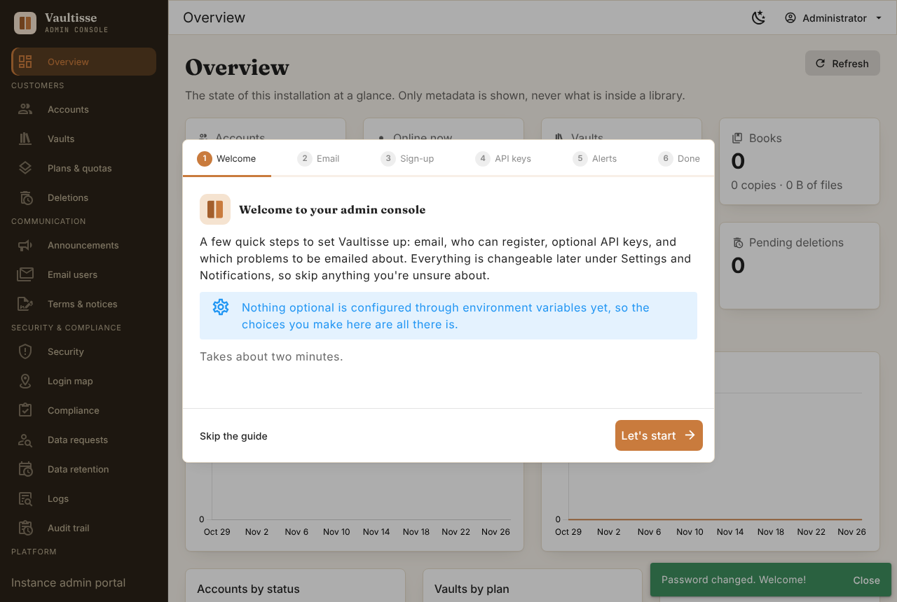
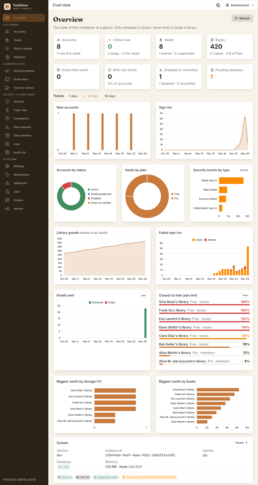
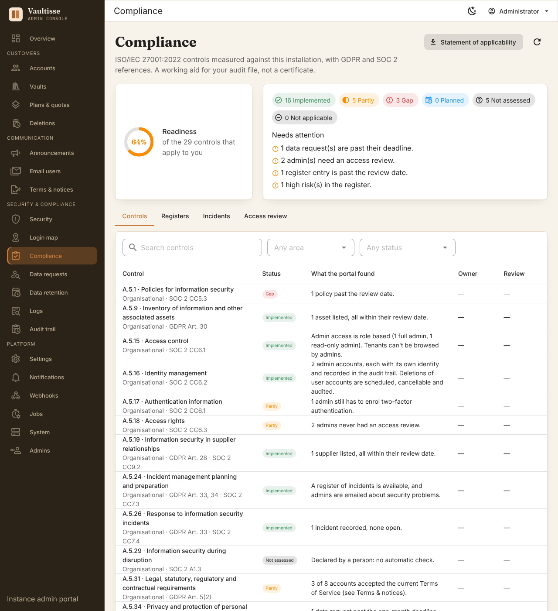

# Vaultisse

**The easiest way to track, organize, and share all your books.**

Vaultisse is an open-source web application for managing physical book collections —
at home, in a school library, or in a small lending library. It tracks where each book
lives, who currently has it on loan, and its full catalog metadata (author, category,
language, format, cover image), and it can look books up automatically by ISBN.

- **Website:** [vaultisse.com](https://vaultisse.com)
- **Live demo (read-only):** [demo.vaultisse.com](https://demo.vaultisse.com) — log in with
  `demo@vaultisse.com` / `VaultisseDemo!2026`
- **Video tutorials:** [youtube.com/@Vaultisse](https://www.youtube.com/@Vaultisse/videos)
- **License:** [MIT](LICENSE)

<p align="center">
  <br>
  
</p>

---

## Table of contents

- [Features](#features)
- [Architecture](#architecture)
  - [Client (frontend)](#client-frontend)
  - [Server (backend)](#server-backend)
  - [How they talk to each other](#how-they-talk-to-each-other)
- [Project structure](#project-structure)
- [Getting started](#getting-started)
  - [Prerequisites](#prerequisites)
  - [1. Clone the repository](#1-clone-the-repository)
  - [2. Set up the database](#2-set-up-the-database)
  - [3. Configure the server](#3-configure-the-server)
  - [4. Run the server](#4-run-the-server)
  - [5. Run the client](#5-run-the-client)
- [Configuration](#configuration)
  - [Option 1: the admin panel (easiest)](#option-1-the-admin-panel-easiest)
  - [Option 2: environment variables](#option-2-environment-variables)
  - [Which one wins](#which-one-wins)
- [Admin panel](#admin-panel)
- [Building for production](#building-for-production)
- [Deploying with Docker](#deploying-with-docker)
- [Releasing a new version](#releasing-a-new-version)
- [Internationalization](#internationalization)
- [Roadmap](#roadmap)
- [Contributing](#contributing)
- [Security](#security)
- [License](#license)

---

## Features

- Add books manually or by scanning/typing an ISBN (auto-filled via the Google Books
  API, falling back to Open Library and then LibraryThing for the cover when no match
  is found)
- Look up a cover for a book already in the library that's missing one, using the same
  Google Books → Open Library → LibraryThing fallback
- Track individual physical copies ("stock") of a book independently — each copy has
  its own status: available, booked/on loan, damaged, or not available
- Record who a book is currently lent to, using a customer/borrower directory
- Organize books by category, author, language, and format
- Organize physical copies by shelf/location, so you always know where to find them
- Print barcode/ISBN labels for shelving and quick re-scanning
- Full-text search across the catalog
- A dashboard with collection statistics and charts
- An optional **admin panel** on its own port for whoever runs the installation: settings without
  editing `.env`, accounts, vaults, plans, security, logs, GDPR tools and compliance evidence
  (see [docs/ADMIN.md](docs/ADMIN.md))
- Multi-language UI (English, Spanish, Catalan, Italian, French, German)
- Built-in `/docs` help pages, rendered from Markdown, in the same languages
- Cookie/session-based authentication with JWT, password hashing, optional OIDC/SSO
  (Authentik and other IdPs), rate limiting, and secure HTTP headers out of the box

## Architecture

Vaultisse is a classic **SPA + REST API** monorepo: a Vue 3 single-page app talks to
an Express/PostgreSQL backend over a JSON API. In production the backend also serves
the built frontend, so the whole app runs as a single Node.js process behind one port.

```
┌─────────────────────────┐        HTTPS / cookies        ┌──────────────────────────┐
│  client/  (Vue 3 SPA)   │ ─────────────────────────────▶ │  server/ (Express API)  │
│  Vuetify UI components  │ ◀───────────────────────────── │  JWT auth, business      │
│  built with Vite        │        JSON over /api/rest     │  logic, PostgreSQL       │
└─────────────────────────┘                                └────────────┬─────────────┘
                                                                         │
                                                                         ▼
                                                              ┌────────────────────┐
                                                              │   PostgreSQL DB    │
                                                              └────────────────────┘
```

### Client (frontend)

Located in [`client/`](client). A Vue 3 + Vuetify 3 single-page application built with
Vite.

- **`src/views/`** – one folder per feature area (book, authors, categories, customers,
  locations, dashboard, search, settings, docs, legal). Each contains the page-level
  Vue components for that feature.
- **`src/controller/`** – view controllers that hold page state/logic and call
  services, keeping `.vue` files focused on markup (`BaseController.ts` is the shared
  base class).
- **`src/service/`** – `ApplicationService.ts`, the app-wide state holder. The HTTP
  calls (one service per resource) live in the shared `packages/api-client` package
  and are used through the `api` object from `src/plugins/api.ts`
  (e.g. `api.books.getBook(12)`).
- **`src/model/`** – TypeScript classes/interfaces mirroring the domain entities
  (book, author, category, customer, location, format, language, user).
- **`src/router/`** – Vue Router setup; each feature has its own route file under
  `src/router/routes/`.
- **`src/plugins/i18n/`** – Vue I18n configuration and the generated label map used
  for translations (labels themselves are stored in the database — see
  [Internationalization](#internationalization)).
- **`src/components/`** – shared/reusable UI components (dialogs, tables, pickers,
  the barcode/ISBN scanner, label printing, etc.).

The client is served under the `/app` base path (see `vite.config.ts` and
`router/Router.ts`) and never talks to the database directly — everything goes
through the REST API at `/api/rest/*`.

### Server (backend)

Located in [`server/`](server). A Node.js + Express + TypeScript REST API backed by
PostgreSQL.

- **`src/index.ts`** – process entry point; boots the singleton `AppService`.
- **`src/AppService.ts`** – the application core. Owns the Express app, the
  PostgreSQL connection pool (`pg.Pool`), configuration read from environment
  variables, the logger, and helpers for JWT sessions and password hashing
  (bcrypt). It also wires up global middleware: `helmet` (secure headers),
  `express-rate-limit` (brute-force/DoS mitigation), `cors` (restricted to the
  configured frontend origin), and cookie/body parsing.
The API is layered `types/ → repositories/ → services/ → controllers/ → routes/`,
one set of files per resource (books, authors, categories, locations, loans,
dashboard, customer, import, app, user, auth, ...):

- **`src/routes/`** – one Express router per resource, registered in `Routes.ts`
  under the `/api/rest` prefix: `AppRoute`, `BooksRoute`, `LocationRoute`,
  `CustomerRoute`, `AuthorRoute`, `CategoriesRoute`, `UserRoute`, `DashboardRoute`.
  `AuthRoute` is mounted separately at the root (`/`) and handles login, register,
  logout, OIDC/SSO, and serving the built SPA in production. Routes do nothing but
  wire `middleware → controller.method` for each path — no business logic.
- **`src/controllers/`** – thin HTTP↔service glue: parse the request, call a
  service, map the result (or a thrown `DomainError`) to a response. No SQL, no
  business rules.
- **`src/services/`** – business logic and orchestration. Pure functions of
  `(pool, ...domain args) → domain result` (no Express types), calling one or
  more repositories and throwing a typed `DomainError` subclass (see
  `src/errors/DomainError.ts` — `NotFoundError`, `ConflictError`,
  `ValidationError`, `ForbiddenError`, `UnauthorizedError`, `NotAcceptableError`)
  for expected failures.
- **`src/repositories/`** – data access behind plain exported functions taking
  `Pool | PoolClient` as the first argument: one focused SQL statement each, or
  (for `BookMetadataRepository.ts`/`OidcRepository.ts`) a call to an external
  API/IdP. `withTransaction.ts` wraps a `BEGIN`/`COMMIT`/`ROLLBACK` around a
  callback for the handful of endpoints that write across more than one query.
- **`src/middlewares/AuthMiddleware.ts`** – `requireAuth`/`requireAuthPage`
  guards. Verify the JWT stored in the `token` cookie, check the user still
  exists and isn't disabled, check the session hasn't been individually
  revoked, and silently refresh the cookie when it's close to expiry — see
  [docs/AUTHENTICATION.md](docs/AUTHENTICATION.md). In development, setting
  `ALLOW_DEV_AUTH=true` bypasses login with a fake session — never enable
  this in production.
- **`src/types/`** – one file per resource holding the interfaces its
  repositories return (plus the pre-existing book/stock shapes, search filters,
  and app error types).
- **`src/utils/Logger.ts`** – lightweight file logger (`LOGGER_PATH` env var).
  `src/utils/` otherwise holds small dependency-free helpers (two-factor auth,
  file-signature/ISBN validation, session-cookie option builders) used by the
  layers above but not tied to any one resource.
- **`src/assets/`** – static assets shipped with the API: the standalone
  `login.html`/`register.html` pages, background image, and (in production) the
  built client bundle served from `assets/app`.

Authentication is a JWT in an httpOnly cookie, but not purely stateless:
`requireAuth` also checks a per-user `token_version` counter (bumped on
password change, invalidating every device at once) and a per-login
`user_sessions` row (so "log out this device" in Settings can revoke just
one), on every protected request. Passwords are hashed with bcrypt (12 salt
rounds) and never stored or logged in plaintext. See
[docs/AUTHENTICATION.md](docs/AUTHENTICATION.md) for the full session/revocation model.

### How they talk to each other

- In **development**, Vite runs its own dev server (`npm run dev` in `client/`) and
  proxies any request to `/api/rest/*` to the API (`http://localhost:<API_PORT>` by
  default, see `vite.config.ts`). The API runs separately via `npm run dev` in
  `server/` (`tsx watch`).
- In **production**, the client is built into static files and the Express server
  serves them directly (see `AuthRoute.ts`, which serves `index.html` for `/app` and
  `/app/*`, guarded by `requireAuth`) — there is a single process and a single port.

For deeper dives into specific parts of the codebase (not to be confused with
the in-app `/docs` help pages, which are end-user-facing), see
[docs/](docs/README.md).

## Project structure

```
vaultisse/
├── client/                # Vue 3 + Vuetify frontend (see client/README.md)
│   └── src/
│       ├── views/         # Page components, grouped by feature
│       ├── controller/    # Page controllers (state + logic)
│       ├── service/       # ApplicationService (app-wide state)
│       ├── model/         # Domain TypeScript models
│       ├── router/        # Vue Router configuration
│       ├── components/    # Shared UI components
│       └── plugins/       # i18n, Vuetify, API client setup (api.ts)
├── admin/                 # Vue 3 + Vuetify admin portal (optional, see docs/ADMIN.md)
├── packages/              # Shared workspace packages (client, admin + future browser extensions)
│   ├── types/             # @vaultisse/types: API request/response types
│   └── api-client/        # @vaultisse/api-client: axios clients (user API and admin API)
├── server/                # Express + TypeScript REST API
│   └── src/
│       ├── admin/         # The admin portal's API, auth, settings, security (own port, off by default)
│       ├── routes/        # One Express router per resource
│       ├── middlewares/   # requireAuth (JWT) middleware
│       ├── types/         # Server-side types (DB rows, route inputs)
│       ├── utils/         # Logger, etc.
│       └── assets/        # Static login/register pages, prod client bundle
├── assets/
│   └── db/                # SQL schema (databaseSchema.sql) + upgrade/ (dated upgrade files)
├── package.json           # npm workspaces root (client, admin, server, packages/*) + release version anchor
├── package-lock.json      # the single lockfile for all workspaces
├── Dockerfile             # production image, built from the repo root
└── LICENSE
```

## Getting started

### Prerequisites

- [Node.js](https://nodejs.org/) 22.x and npm 10.x (used to develop this project;
  other recent LTS versions likely work but aren't tested)
- [PostgreSQL](https://www.postgresql.org/) 13+ (any recent version should do)
- A [Google Books API key](https://developers.google.com/books) (optional — the
  server looks up ISBNs on [Open Library](https://openlibrary.org/developers/api)
  first; a key only adds Google Books on top)
- A [LibraryThing developer key](https://www.librarything.com/services/keys.php) (optional,
  free with any LibraryThing account — used as a third cover-lookup fallback when neither
  Google Books nor Open Library has one; skipped entirely if `LIBRARYTHING_API_KEY` isn't set)

### 1. Clone the repository

```bash
git clone https://github.com/AlbertAmat/vaultisse.git
cd vaultisse
```

### 2. Set up the database

Create a PostgreSQL database and load the schema — `databaseSchema.sql` is always
kept up to date, so this is everything a new install needs:

```bash
createdb vaultisse
psql -d vaultisse -f assets/db/databaseSchema.sql
```

> There is no admin UI for the very first user, and none is needed: `/register` is a
> normal, always-available page regardless of `ALLOW_DEV_AUTH` (see `AuthRoute.ts`) —
> after loading the schema, just start the server and register through it like any
> other account. Inserting a row into `users` directly is only useful if you want to
> skip that page entirely.

The version-named files in `assets/db/upgrade/` (`1.0.0/1.sql`, `1.0.0/2.sql`,
...) are **not** for new installs — they're incremental upgrades for a
database that's already running an older version of the schema (see
[`assets/db/upgrade/README.md`](assets/db/upgrade/README.md) for the full
convention). If you're upgrading an existing instance instead of setting one
up fresh, you don't need to touch these yourself: the server applies
whatever it's missing automatically on startup (`npm run dev`/`npm start`),
however far behind it is, and records what it's applied so it's never
redone. Manually running one of these files is only for recovery/debugging —
see that directory's README for how.

### 3. Configure the server

Create `server/.env` (this file is git-ignored) with:

```dotenv
API_PORT=3000
DB_HOST=localhost
DB_PORT=5432
DB_NAME=vaultisse
DB_USER=your_db_user
DB_PASSWORD=your_db_password
GOOGLE_BOOKS_API_KEY=            # optional, see Prerequisites
LIBRARYTHING_API_KEY=            # optional, see Prerequisites
LOGGER_PATH=./logs.log
FRONT_END_URL=http://localhost:5173
JWT_SECRET=replace_with_a_long_random_string
SESSION_TIME=3600000             # milliseconds
ALLOW_DEV_AUTH=false             # NEVER true in production
```

Generate a strong `JWT_SECRET`, for example: `openssl rand -hex 32`.

### 4. Run the server

The repository is an npm workspaces monorepo (`client`, `server`, `packages/*`): install
once, from the repo root.

```bash
npm install            # repo root: installs every workspace
npm run dev:server     # starts the API with tsx watch on API_PORT
```

### 5. Run the client

```bash
npm run dev:client     # starts Vite; proxies /api/rest to the server
```

Open the URL Vite prints (typically `http://localhost:5173/app`) in your browser.

## Configuration

Vaultisse can be configured in two ways. **You can mix them**, and the admin panel is the easiest.

| | Admin panel | Environment variables |
|---|---|---|
| Where | A web page, on its own port (`http://localhost:3001`) | The `.env` file (or your container's environment) |
| Changing a value | Edit, press Save. No restart | Edit the file, restart the container |
| Email, registration, single sign-on, API keys, limits, notifications, retention | Yes, with a setup guide | Yes |
| Database connection, secrets, ports, proxy | No: needed before the panel can start | Yes (only these are required) |
| Secrets (SMTP password, API keys) | Stored encrypted, shown as "set" | Plain text in the file |
| Test buttons (send a test email, check an API key) | Yes | No |
| Best for | Almost everyone | Automation, Kubernetes, reproducible deployments |

### Option 1: the admin panel (easiest)

Put the handful of variables that must exist before the database can be reached in `.env`, switch the panel on,
and set everything else in your browser.

```bash
cp .env.minimal.example .env        # fill in DB_PASSWORD, JWT_SECRET, SETTINGS_ENCRYPTION_KEY (openssl rand -hex 32)
docker compose up -d
docker compose logs app             # the first admin's username and password are printed here, once
```

The file contains the minimum, and the important line is `ADMIN_ENABLED=true`:

```dotenv
DB_NAME=vaultisse
DB_USER=vaultisse
DB_PASSWORD=<openssl rand -hex 24>
JWT_SECRET=<openssl rand -hex 32>
SETTINGS_ENCRYPTION_KEY=<openssl rand -hex 32>
FRONT_END_URL=http://localhost:3000     # the address your users open
ADMIN_ENABLED=true                      # turns the admin panel on
ADMIN_URL=http://localhost:3001         # the address the panel is opened at
```

1. Open `ADMIN_URL`. Sign in with the generated `admin@vaultisse.local` and the password from the logs.
2. Choose a new password and set up two-factor authentication (an authenticator app). Both are mandatory.
3. A **setup guide** opens: email (with a *Send a test email* button), registration, single sign-on, notifications.
   Skip what you don't need, everything can be changed later under **Settings**.

<p align="center"></p>

The panel is published on `127.0.0.1` only. To reach it from elsewhere, prefer a VPN or an SSH tunnel (`ssh -L 3001:127.0.0.1:3001 your-server`).
If you do put it behind a reverse proxy, give it its own domain (for example `adm.example.com`) pointing at the admin port, set
`TRUST_PROXY=true`, and limit it with `ADMIN_ALLOWED_IPS`. Everything the panel can do is described in **[docs/ADMIN.md](docs/ADMIN.md)**.

### Option 2: environment variables

Everything can also be set in `.env` (or the container's environment), which is how Vaultisse worked before the
panel existed and still works if you never turn the panel on. [`.env.example`](.env.example) lists every variable
with a comment. In short:

| Needed to start | Meaning |
|---|---|
| `DB_NAME`, `DB_USER`, `DB_PASSWORD` (and `DB_HOST`, `DB_PORT` outside Docker) | The PostgreSQL connection |
| `JWT_SECRET` | Signs sessions. `openssl rand -hex 32` |
| `FRONT_END_URL` | The address users open (CORS, security headers, links in emails) |

| Optional, by topic | Variables |
|---|---|
| Email (verification links, notifications) | `SMTP_HOST`, `SMTP_PORT`, `SMTP_SECURE`, `SMTP_USER`, `SMTP_PASSWORD`, `SMTP_FROM` |
| Who can register | `REGISTRATION_ENABLED`, `REGISTRATION_REQUIRES_APPROVAL` |
| Single sign-on | `OIDC_ISSUER`, `OIDC_CLIENT_ID`, `OIDC_CLIENT_SECRET`, `OIDC_REDIRECT_URI`, `SSO_ONLY` |
| Book lookup | `GOOGLE_BOOKS_API_KEY`, `LIBRARYTHING_API_KEY` |
| Upload limits | `MAX_EBOOK_FILE_SIZE_MB`, `MAX_IMPORT_FILE_SIZE_MB` |
| Inactive accounts | `ACCOUNT_INACTIVITY_DAYS`, `ACCOUNT_DELETION_NOTICE_DAYS` |
| Running behind a proxy / over HTTP | `TRUST_PROXY`, `ALLOW_HTTP` |
| Admin panel | `ADMIN_ENABLED`, `ADMIN_PORT`, `ADMIN_URL`, `ADMIN_ALLOWED_IPS`, `SETTINGS_ENCRYPTION_KEY` |

### Which one wins

If you use both, **the admin panel wins**: for every setting the value used is what is saved in the panel, then the
environment variable, then the built-in default. At every start the container prints a table that shows, for each
setting, the value from the environment, the value from the panel and which one is applied, so you can see at a glance
why an environment variable is being ignored. Each setting in the panel says the same on its own field, and a
*Danger zone* (confirmed with a code sent by email) clears everything saved in the panel to go back to the
environment variables.

```
SETTING                  ENV VAR          ADMIN PANEL      APPLIED      NOTE
SMTP_HOST                smtp.old.com     smtp.new.com     admin panel  env var IGNORED (the admin panel overrides it)
REGISTRATION_ENABLED     true             -                env var
```

## Admin panel

The optional admin panel is a separate console for whoever *runs* the installation, on its own port or domain. It is
**off by default**. It lets you manage accounts, vaults, plans and settings without touching the database, and it
is built so an admin **never sees what is inside someone's library**.

<p align="center">
  
  
</p>

> **Keep it private.** The panel can be exposed to the internet, but we recommend **not exposing it**: open it locally, over a VPN or through an
> SSH tunnel. If you must expose it, limit it with `ADMIN_ALLOWED_IPS` and serve it over HTTPS (see [Securing it](docs/ADMIN.md#securing-it)).

What it covers: configuration without env vars (with test buttons), accounts and vaults (bulk actions, merge two accounts,
change an email, transfer or clear a vault), plans and quotas, announcements and a read-only maintenance mode, emailing the
users, security (automatic IP blocking, sessions, a login map), logs and a tamper-proof audit trail, GDPR data requests
and personal-data export, data retention periods, a compliance page for ISO/IEC 27001, background jobs, webhooks to Slack,
Discord and Telegram, and email alerts to the admins.

**Read the full guide, with a screenshot of every page: [docs/ADMIN.md](docs/ADMIN.md).**

## Building for production

The supported way to run Vaultisse is the Docker image (see [Deploying with Docker](#deploying-with-docker)),
built from the [`Dockerfile`](Dockerfile). There is no packaged zip/PM2 deployment.

To run it without Docker, clone the repo and build both halves yourself:

```bash
npm install                            # repo root: installs every workspace
npm run build -w @vaultisse/client     # -> client/dist
npm run build -w @vaultisse/server     # type-check + bundle -> server/dist/index.js
```

Then run `NODE_ENV=production node index.js` (with the environment from `.env.example`)
from a folder laid out like the Docker image (see the runtime stage of the
[`Dockerfile`](Dockerfile); the paths are resolved in `server/src/utils/Paths.ts`):

```
index.js        <- server/dist/index.js
node_modules/   <- `npm ci --omit=dev -w @vaultisse/server` from the repo root
assets/         <- server/src/assets (login.html, register.html)
client/         <- client/dist
db/upgrade/     <- assets/db/upgrade
```

The server serves the built client itself, so a single Node.js process is all you need.

## Deploying with Docker

Every push of a `vX.Y.Z` tag builds a production image and publishes it to GitHub
Container Registry at `ghcr.io/albertamat/vaultisse` (see
[Releasing a new version](#releasing-a-new-version)). The image bundles the compiled
server and the built client into one process — there is no separate frontend container.

To run it on a server with Docker installed:

```bash
mkdir -p assets/db
curl -O https://raw.githubusercontent.com/AlbertAmat/vaultisse/main/docker-compose.yml
curl -O https://raw.githubusercontent.com/AlbertAmat/vaultisse/main/.env.example
curl -o assets/db/databaseSchema.sql https://raw.githubusercontent.com/AlbertAmat/vaultisse/main/assets/db/databaseSchema.sql
cp .env.example .env
# edit .env: set JWT_SECRET, DB_PASSWORD, FRONT_END_URL, etc.
# (or start from .env.minimal.example and set the rest in the admin panel, see Configuration)
docker compose up -d
```

This starts two containers: `db` (PostgreSQL, seeded from
`assets/db/databaseSchema.sql` — the file fetched above — on first run) and `app`
(the image above). `docker-compose.yml` mounts that file by its relative path, so it
must exist at `assets/db/databaseSchema.sql` next to the compose file, not just be
present somewhere in the clone. Pin `APP_TAG` in `.env` to a specific released version
rather than `latest` if you want upgrades to be a deliberate step.

Once `app` is up, open `FRONT_END_URL` and go to `/register` to create your first
account — it's a normal, always-available page, not gated by `ALLOW_DEV_AUTH` (which
should stay `false`, see below). There's no separate admin role; every account has the
same access.

A few things worth knowing before pointing this at a real server:

- **Upgrading is just bumping `APP_TAG` and re-running `docker compose up -d`.**
  The `app` container applies any pending schema changes itself on startup (see
  [`assets/db/upgrade/README.md`](assets/db/upgrade/README.md)) — no manual `psql`
  step, regardless of how far behind it is.
- **`ALLOW_DEV_AUTH` must stay `false`.** It bypasses login with a fake session and
  exists only for local development.
- **`DB_HOST`/`DB_PORT` in `.env` are ignored for the `app` container** — it always
  connects to the `db` service on the compose network. They only configure the `db`
  container itself.
- **Logs** are written to `/app/logs` inside the container (`LOGGER_PATH`), persisted
  via the `app-logs` volume.
- To build and run the image locally instead of pulling it:
  `docker build -t vaultisse .`

To build a multi-arch image or push to a different registry, adjust
`.github/workflows/docker-release.yml`.

For step-by-step instructions covering local-only self-hosting, production behind
your own reverse proxy/DNS, production behind Cloudflare Tunnel, and a one-click
**Unraid** template (Docker tab → Add Container, no Compose needed), see
**[docs/DEPLOYMENT.md](docs/DEPLOYMENT.md)**.

## Releasing a new version

The repository root has a `package.json` that exists solely to anchor the release
version (the workspaces aren't published packages and keep their own internal
version fields). To cut a release:

```bash
npm version patch   # or: minor / major
git push --follow-tags
```

`npm version` bumps `package.json`, commits it, and creates a `vX.Y.Z` git tag.
Pushing that tag triggers `.github/workflows/docker-release.yml`, which builds the
Docker image, pushes `ghcr.io/albertamat/vaultisse:X.Y.Z` and `:latest`, and creates
a matching GitHub Release with auto-generated notes.

For a beta, give `npm version` an explicit prerelease version (`npm version 1.3.7-beta.1`).
A tag with a suffix is published as `ghcr.io/albertamat/vaultisse:1.3.7-beta.1` only (never
`:latest`) and its GitHub Release is marked as a prerelease.

The running app version is available at `GET /api/rest/app/version` (unauthenticated),
useful for confirming what's actually deployed.

The first time you release, open the new package under **Packages** on the GitHub repo
and set its visibility (packages default to private) so `docker pull` works without
authentication on your server.

## Internationalization

The UI currently ships in English, Spanish, Catalan, Italian, French, and German. Labels are stored
in the database (`app_languages` / `app_labels` tables in `databaseSchema.sql`) and
loaded into the client's Vue I18n instance — this keeps translations editable
without a redeploy. The `/docs` help pages are Markdown files rendered per-language
in the client. See [Contributing](#contributing) for how to add a new language.

## Roadmap

Looking for ways to contribute? [docs/ROADMAP.md](docs/ROADMAP.md) lists feature ideas
that don't have anyone working on them yet — Kindle/Kobo sync, SSO, an admin
panel, library sharing for families, and more.

## Contributing

Contributions are welcome! Please read [CONTRIBUTING.md](CONTRIBUTING.md) for how to
set up your environment, coding conventions, and how to submit a pull request. All
participants are expected to follow the [Code of Conduct](CODE_OF_CONDUCT.md).

## Security

Please **do not** open a public issue for security vulnerabilities. See
[SECURITY.md](SECURITY.md) for how to report them responsibly.

## License

This project is licensed under the [MIT License](LICENSE).

## Topics

books reading organization tracking lending library collection management
open-source inventory personal-library cataloging
